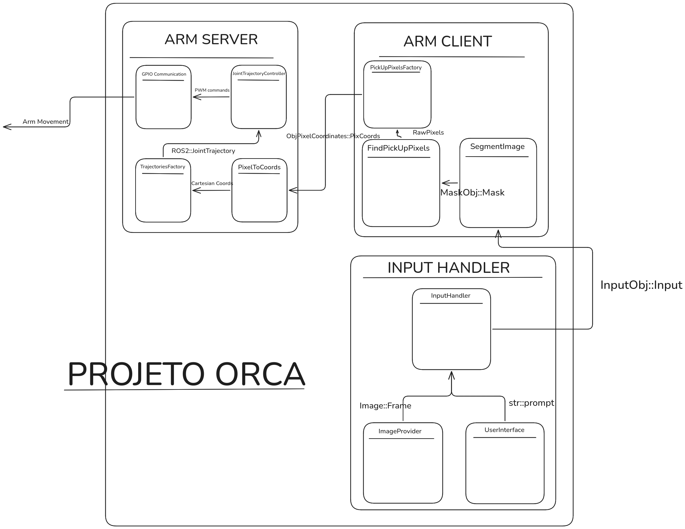

# Documentação

- [Arquitetura](architecture.md) descreve os componentes derivados do diagrama
  do sistema e o fluxo de dados entre eles.
- [Operação](operation.md) descreve o ciclo de coleta e colocação e o
  comportamento de pausa.
- [Configuração](configuration.md) lista as configurações necessárias para uma
  instalação real.
- [Desenvolvimento](development.md) descreve o fluxo planejado de
  desenvolvimento local e em hardware.

## Diagrama do projeto

O arquivo original está disponível em
[diagrams/ORCAdiagram.png](diagrams/ORCAdiagram.png).
