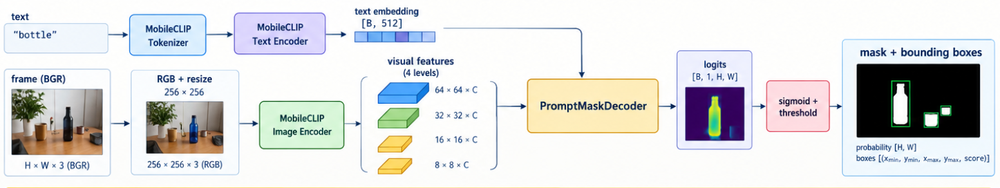

# ZeroShotDet

## Objetivo

`ZeroShotDet` é o backend de percepção zero-shot usado pelo cliente do braço.
Ele recebe um quadro BGR e uma descrição textual, produz uma máscara de
probabilidade por pixel e extrai caixas delimitadoras para os componentes
conectados da máscara.

O backend não conhece a câmera, a calibração ou o manipulador. Sua saída deve
ser tratada como percepção visual e encaminhada para os componentes de seleção
de pixels e conversão de coordenadas.

## Arquitetura



O backbone MobileCLIP é carregado com os pesos pré-treinados e permanece
congelado durante a inferência. O decoder SAGS transforma a pirâmide de
features visuais em uma máscara condicionada pelo embedding do texto.

## Estrutura dos módulos

| Arquivo | Responsabilidade |
| --- | --- |
| `config.py` | Define `SAGSConfig`, canais esperados e dimensão dos embeddings. |
| `backbone.py` | Inicializa o MobileCLIP, congela seus parâmetros e expõe os embeddings de texto e os quatro mapas visuais. |
| `decoder.py` | Projeta a pirâmide visual, combina-a com o prompt e produz logits de máscara. |
| `model.py` | Compõe backbone e decoder em `SAGSModel`. |
| `InferenceEngine.py` | Faz carregamento de checkpoints, pré-processamento de quadros, inferência e extração de caixas. |

### Fluxo do decoder

1. Cada mapa visual é projetado para `decoder_dim` canais por uma convolução
   lateral `1x1`.
2. A fusão começa no mapa de menor resolução.
3. O mapa é redimensionado para cada nível anterior e somado ao mapa lateral
   correspondente.
4. Blocos convolucionais suavizam a pirâmide fundida.
5. O embedding textual de 512 dimensões é projetado para `decoder_dim` e
   expandido espacialmente.
6. Features visuais e textuais são concatenadas e convertidas em um canal de
   logits.
7. Os logits são interpolados para o tamanho original do quadro e convertidos
   em probabilidade por `sigmoid`.

## Configuração e checkpoints

As configurações suportadas atualmente são `mobileclip_s0`, `mobileclip_s1` e
`mobileclip_s2`. O checkpoint de backbone e o checkpoint do decoder precisam
ser compatíveis com a mesma arquitetura.

Os pesos de desenvolvimento disponíveis são:

```text
src/arm_client/SegmentImage/weights/mobileclip_s0.pt
src/arm_client/SegmentImage/weights/sags_mobileclip_s0_v2.pt
```

O `SAGSConfig` armazenado no checkpoint do decoder define `model_arch`,
`image_size` e `decoder_dim`. O `InferenceEngine` usa essa configuração para
construir o modelo antes de carregar os pesos do decoder.

## API de inferência

```python
from ZeroShotDet.InferenceEngine import inferenceEngine

engine = inferenceEngine(
    prompt="bottle",
    threshold=0.5,
    device="cpu",
)

boxes, probability = engine.predict_frame_bounding_boxes(
    frame,
    use_cached=True,
)
```

Cada caixa tem o formato:

```text
(x_min, y_min, x_max, y_max, mean_score)
```

`probability` é um array NumPy com a probabilidade da máscara para cada pixel
do quadro. A lista de caixas é ordenada pela área do retângulo em ordem
decrescente. Componentes com área inferior a oito pixels são descartados.

Quando um prompt é fornecido ao construtor, seu embedding é calculado uma vez
e reutilizado com `use_cached=True`. Para alterar o objeto consultado, crie
uma nova instância ou use o caminho de inferência sem cache.

## Teste de webcam

No diretório raiz do repositório:

```bash
python3 tests/arm_client/test_zero_shot_webcam.py \
  --prompt bottle \
  --camera 0 \
  --threshold 0.5
```

Pressione `q` ou `Esc` para encerrar. A execução requer uma câmera acessível,
um display para as janelas OpenCV, os dois checkpoints e as dependências
Python do MobileCLIP.

## Limitações conhecidas

- O pré-processamento atual redimensiona o quadro para um quadrado de
  `image_size`; isso pode distorcer objetos em câmeras com proporção diferente.
- A máscara é convertida em componentes conectados simples. O backend não
  executa supressão de caixas duplicadas nem rastreamento entre quadros.
- Os caminhos padrão do `InferenceEngine` dependem do diretório de execução;
  o smoke test fornece caminhos absolutos derivados da raiz do repositório.
- A qualidade da máscara depende do limiar escolhido, da iluminação e do
  vocabulário usado no prompt.
